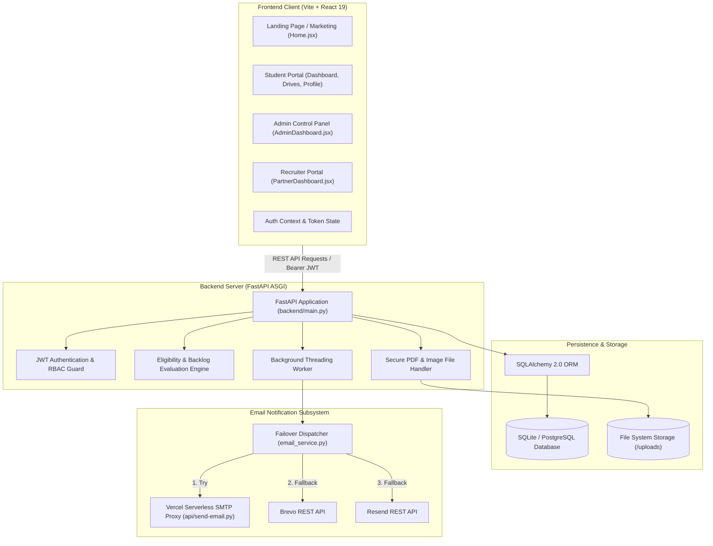
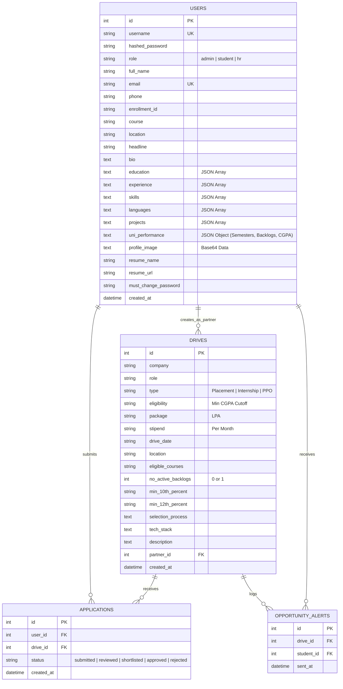

# 🚀 AlignNova — Enterprise Campus Placement & Career Ecosystem

> **A Next-Generation, Full-Stack Placement Management Platform engineered for Universities, Students, and Corporate Recruiters.**  
> Built with **React 19**, **FastAPI**, **SQLAlchemy**, **Tailwind CSS**, and an **Asynchronous Multi-Provider Notification Pipeline**.

---

## 📑 Table of Contents
1. [Project Overview & Problem Statement](#-project-overview--problem-statement)
2. [Key USPs & Core Differentiators](#-key-usps--core-differentiators)
3. [System Architecture](#-system-architecture)
4. [Technology Stack & Architectural Rationale](#-technology-stack--architectural-rationale)
5. [Core Functional Modules](#-core-functional-modules)
6. [System Workflows & Sequence Diagrams](#-system-workflows--sequence-diagrams)
7. [Database Schema & Data Models](#-database-schema--data-models)
8. [API Architecture & Endpoint Reference](#-api-architecture--endpoint-reference)
9. [Security & Authentication Architecture](#-security--authentication-architecture)
10. [Repository Structure](#-repository-structure)
11. [Installation & Local Setup Guide](#-installation--local-setup-guide)
12. [Deployment & DevOps](#-deployment--devops)
13. [Presentation Walkthrough & Demo Cheat-Sheet](#-presentation-walkthrough--demo-cheat-sheet)

---

## 🌟 Project Overview & Problem Statement

### The Problem
Traditional campus placement processes in higher education institutions rely heavily on:
* **Fragmented Spreadsheets & Google Forms**: Scattered student records leading to version conflicts and missing profile data.
* **Manual Eligibility Verification**: Training & Placement (T&P) officers manually calculate CGPA cutoffs, 10th/12th percentages, and verify active backlogs across hundreds of applicants.
* **Unstructured Communication**: Mass WhatsApp and Telegram messages result in students missing deadlines or applying for drives for which they are ineligible.
* **Lack of Direct Recruiter Collaboration**: Companies must interact through intermediaries, causing delays in talent shortlisting and interview scheduling.

### The AlignNova Solution
**AlignNova** is an end-to-end placement ecosystem uniting **Students**, **Placement Administrators**, and **Corporate Recruiters (HRs)** into a single authenticated workspace. It automates eligibility vetting, streamlines document and marksheet verification, delivers targeted real-time email alerts, and provides comprehensive placement analytics.

```
┌────────────────────────────────────────────────────────────────────────┐
│                        ALIGNNOVA UNIFIED ECOSYSTEM                      │
├─────────────────────┬──────────────────────────┬───────────────────────┤
│   STUDENT PORTAL    │   ADMIN / T&P PORTAL     │  CORPORATE PARTNERS   │
│  • Verified Profile │  • Drive Orchestration   │  • Verified Talent    │
│  • Automated Filter │  • Smart Eligibility Rule│  • Candidate Search   │
│  • 1-Click Apply    │  • Email Broadcast Engine│  • Application Review │
│  • Status Tracking  │  • Placement Analytics   │  • Drive Postings     │
└─────────────────────┴──────────────────────────┴───────────────────────┘
```

---

## 💎 Key USPs & Core Differentiators

AlignNova features several tailored design decisions specifically optimized for university environments:

1. **Automated Multi-Dimensional Eligibility Engine**
   * Computes eligibility based on **Aggregate CGPA**, **10th Standard %**, **12th Standard %**, **Live Active Backlogs**, and **Departmental Degree Whitelisting**.
   * Students only see and apply for recruitment drives for which they are strictly qualified, eliminating wasted recruiter hours.

2. **Asynchronous Background Broadcast Engine**
   * When an Admin publishes or updates a recruitment drive, an asynchronous worker evaluates the entire student pool in seconds.
   * Personalized, branded HTML invitation alerts are broadcast **only to eligible candidates**, with deduplication logic to prevent spam.

3. **3-Tier Resilient Email Delivery Pipeline**
   * Combines an internal proxy with commercial transactional APIs:
     * **Primary**: Vercel Serverless SMTP Proxy (utilizing secure port 443 with TLS).
     * **Secondary**: Brevo (Sendinblue) Transactional REST API.
     * **Tertiary**: Resend API.
   * Features automatic zero-downtime failover if a provider fails or hits rate limits.

4. **Zero-Trust Onboarding with Single-Use Cryptographic Tokens**
   * Students and Corporate Partners are onboarded securely without default passwords.
   * The platform issues cryptographically signed, expiring JWT setup links directly to institutional emails.

5. **Granular Academic Tracking (Semesters I through VIII)**
   * Students maintain individual semester SGPA, cumulative CGPA, live backlogs, closed backlogs, and verifiable marksheet PDFs.

---

## 🏛️ System Architecture

AlignNova follows a clean, decoupled client-server architecture:



### Request Lifecycle & Routing Architecture
* **Single-Page Application (SPA)**: The React application is bundled into `frontend_dist/`.
* **FastAPI SPA Catch-All**: In production, FastAPI serves the pre-built React bundle directly via static mounts and a wildcard fallback (`/{full_path:path}`), allowing client-side React Router navigation without routing clashes.
* **Stateless Token Auth**: All protected `/api/*` endpoints require an `Authorization: Bearer <JWT>` header, evaluated by FastAPI dependencies.

---

## 🛠️ Technology Stack & Architectural Rationale

### 1. Frontend Architecture
| Technology | Version | Purpose & Rationale |
| :--- | :--- | :--- |
| **React** | `^19.2.6` | Modern component-based reactive UI, fast DOM reconciliation, hooks-driven state. |
| **Vite** | `^8.0.12` | Next-generation frontend tooling providing lightning-fast HMR and optimized production bundles. |
| **Tailwind CSS** | `^3.4.19` | Utility-first CSS framework enabling a sleek, responsive design with dark mode support. |
| **React Router DOM** | `^7.18.0` | Client-side declarative routing with guarded routes (`RequireStudent`, `RequireAdmin`, `RequireHr`). |
| **Google Fonts** | CDN | *Plus Jakarta Sans* typography for a clean, modern aesthetic. |
| **Material Symbols** | CDN | Consistent, lightweight vector iconography across all dashboards. |

### 2. Backend Architecture
| Technology | Version | Purpose & Rationale |
| :--- | :--- | :--- |
| **FastAPI** | Latest | High-throughput asynchronous Python web framework with native async support and automatic OpenAPI documentation. |
| **Uvicorn / Gunicorn** | Latest | Production-grade ASGI server running multi-worker processes for concurrency. |
| **Pydantic** | Latest | Robust data validation and schema enforcement for incoming JSON payloads. |
| **SQLAlchemy** | Latest | Industry-standard Python ORM providing clean database abstraction, migrations, and relationship mapping. |
| **Passlib + Bcrypt** | `4.0.1` / `1.7.4` | Enterprise-grade password hashing with salted bcrypt rounds. |
| **Python-JOSE** | Latest | Secure encoding, signing, and decoding of JSON Web Tokens (HS256). |
| **Python-Multipart** | Latest | Streaming multipart file uploads for student resumes and academic marksheets. |

### 3. Database & File Storage
* **SQLite (Development)**: Zero-configuration local database for local development and testing.
* **PostgreSQL (Production)**: Supported via `DATABASE_URL` and `psycopg2-binary` for concurrent multi-user production environments.
* **Local Volume File Storage**: Uploaded resumes and marksheets are validated, given cryptographically unique filenames (`uuid.uuid4()`), and served through secure streaming endpoints.

### 4. Asynchronous Email & Notification Engine
* **Python Threading (`threading.Thread`)**: Non-blocking background workers dispatch email notifications without slowing down API responses.
* **Resilient Multi-Provider Fallback**:
  1. **Vercel Serverless Proxy** (`api/send-email.py`): Python serverless microservice proxying SMTP traffic over HTTPS (port 443) to bypass host network blocks on ports 587/465.
  2. **Brevo API**: Transactional REST API fallback.
  3. **Resend API**: High-deliverability transactional fallback.

---

## 📦 Core Functional Modules

### 🎓 1. Student Portal
* **Dashboard Overview**: Key metrics including eligible drives count, applied drives, shortlists, and academic profile completeness.
* **Comprehensive Profile Management**:
  * Bio, headline, contact numbers, LinkedIn, and personal portfolio links.
  * Verified enrollment number and degree branch whitelist.
  * Structured JSON arrays for technical skills, languages, projects, and work experience.
  * PDF Resume upload and real-time viewing.
* **Academic & Backlog Tracker**:
  * Semester-wise record (Semesters I to VIII) with individual SGPA.
  * Automatic calculation of aggregate CGPA.
  * Separate counters for **Closed Backlogs** and **Live (Active) Backlogs**.
  * File uploads for verified semester marksheets.
* **Eligible Drives Browser**: Automatically displays recruitment drives matching the student's exact academic profile.
* **One-Click Application Flow**: Direct application submission with duplicate detection.
* **Application Tracker**: Live tracking of application stages (`Submitted` $\rightarrow$ `Reviewed` $\rightarrow$ `Shortlisted` $\rightarrow$ `Approved` / `Rejected`).
* **AlignNova Premium / Pro Showcase**: Features mock interviews, ATS resume optimization, and priority matching.

### 🛡️ 2. Admin & Placement Cell Portal
* **Executive Placement Analytics**: Real-time counters for total enrolled students, active recruitment drives, total applications, placed candidates, and overall placement percentage.
* **Drive Lifecycle Management (CRUD)**:
  * Company profile, job role, drive type (Full-time, Internship, Internship + PPO).
  * Compensation details (CTC package in LPA and monthly stipend).
  * Granular academic cutoffs: Min CGPA, Min 10th %, Min 12th %, Max active backlogs allowed.
  * Department whitelisting (CSE, IT, AI & Analytics, Cyber Security, etc.).
  * Recruitment process breakdown (Aptitude, Technical, Coding, GD, HR rounds).
* **Automatic Broadcast Trigger**: Real-time evaluation of all students followed by background email dispatch upon drive creation or update.
* **Applicant Review & Approval Workflow**: Review applicants per drive and toggle selection statuses.
* **Student Directory & Provisioning**:
  * Manual creation or bulk enrollment of students.
  * Automatic dispatch of welcome onboarding emails with single-use password activation links.
* **Recruiter & Corporate Partner Management**: Provision partner accounts, assign corporate HRs, and host company branding assets.
* **Email Testing & Diagnostics Panel**: Interactive admin tool to inspect environment variables and trigger live test emails.

### 🏢 3. Corporate Partner / Recruiter Portal
* **Talent Pool Discovery**: Browse verified students with filterable criteria (CGPA, active backlogs, departmental specializations).
* **Company Profile & Branding**: Corporate partners upload high-resolution company logos rendered dynamically across recruitment drive cards and student email alerts.
* **Direct Drive Collaboration**: Postings linked directly to partner profiles with company metadata.

---

## 🔄 System Workflows & Sequence Diagrams

### 1. Student Provisioning & Activation Flow
```mermaid
sequenceDiagram
    autonumber
    actor Admin as Placement Admin
    participant Server as FastAPI Server
    participant DB as Database
    participant Email as Email Dispatcher
    actor Student as Student

    Admin->>Server: POST /api/admin/students (Name, Email, Course)
    Server->>DB: Create User Record (must_change_password="1")
    Server->>Server: Generate JWT Set-Password Token (7-day expiry)
    Server-->>Admin: 200 OK (Student Created)
    Server->)Email: Background Thread: Send Welcome Email
    Email->>Student: Deliver Welcome Email with Setup Link
    Student->>Server: GET /set-password?token=...
    Student->>Server: POST /api/set-password (New Password)
    Server->>DB: Update Password Hash & Clear Flag
    Server-->>Student: Return Access Token (Automatic Login)
```

### 2. Drive Creation & Targeted Broadcast Flow
```mermaid
sequenceDiagram
    autonumber
    actor Admin as Placement Admin
    participant Server as FastAPI Server
    participant Engine as Eligibility Engine
    participant DB as Database
    participant Worker as Background Worker
    actor Student as Eligible Student

    Admin->>Server: POST /api/drives (Eligibility Criteria, Package, Timeline)
    Server->>DB: Save Drive Entity
    Server-->>Admin: 200 OK (Drive Created)
    Server->)Worker: Trigger run_broadcast_task()
    Worker->>DB: Fetch All Registered Students
    loop For Every Student
        Worker->>Engine: check_student_eligibility(student, drive)
        alt Meets Criteria (CGPA, 10th/12th %, 0 Backlogs, Course)
            Engine-->>Worker: True + Match Explanation
            Worker->>DB: Check opportunity_alerts_sent
            alt Not Already Sent
                Worker->>DB: Record Sent Alert
                Worker->>Student: Send Branded Alert Email
            end
        else Does Not Meet Criteria
            Engine-->>Worker: False (Skip Student)
        end
    end
```

---

## 🗄️ Database Schema & Data Models

AlignNova uses SQLAlchemy ORM models configured in `backend/database.py`:



---

## 🔌 API Architecture & Endpoint Reference

### 🔐 1. Authentication & Account Lifecycle
| Method | Endpoint | Access | Description |
| :--- | :--- | :--- | :--- |
| `POST` | `/api/login` | Public | OAuth2 password form login. Returns JWT Bearer token & role. |
| `POST` | `/api/signup` | Public | Direct student registration. |
| `GET` | `/api/me` | Authenticated | Returns current authenticated user metadata. |
| `POST` | `/api/set-password` | Token-Guarded | Consumes single-use onboarding token to configure account password. |
| `POST` | `/api/forgot-password` | Public | Generates 1-hour secure password reset token and dispatches reset email. |
| `POST` | `/api/request-activation`| Public | Resends activation credentials link if expired or lost. |

### 👤 2. Student Profile & Academic Records
| Method | Endpoint | Access | Description |
| :--- | :--- | :--- | :--- |
| `GET` | `/api/profile` | Student/User | Retrieves current user profile with academic history. |
| `POST` | `/api/profile` | Student/User | Updates bio, skills, projects, and semester performance. |
| `POST` | `/api/profile/resume` | Student | Uploads verified PDF resume; returns saved URL. |
| `POST` | `/api/profile/marksheet`| Student | Uploads verified semester marksheet PDF or image. |
| `GET` | `/api/uploads/{filename}`| Public/Secure | Streams uploaded resumes and marksheets with proper MIME type. |

### 💼 3. Recruitment Drives & Applications
| Method | Endpoint | Access | Description |
| :--- | :--- | :--- | :--- |
| `GET` | `/api/drives` | Authenticated | For students: returns only qualified drives. For admins/HR: returns all. |
| `GET` | `/api/drives/{id}` | Authenticated | Detailed view of a drive (enforces eligibility check for students). |
| `POST` | `/api/drives` | Admin Only | Creates a drive and triggers background broadcast. |
| `PUT` | `/api/drives/{id}` | Admin Only | Updates drive criteria and sends update notifications. |
| `DELETE`| `/api/drives/{id}` | Admin Only | Deletes recruitment drive record. |
| `POST` | `/api/apply` | Student | Submits application for a recruitment drive. |
| `GET` | `/api/applications` | Authenticated | Students view their applications; Admins view all applications. |
| `POST` | `/api/applications/{id}/status`| Admin Only | Updates application progress (`approved`, `shortlisted`, etc.). |
| `DELETE`| `/api/applications/{id}`| Student/Admin | Withdraws or deletes an application. |

### ⚙️ 4. Administration & Corporate Partners
| Method | Endpoint | Access | Description |
| :--- | :--- | :--- | :--- |
| `GET` | `/api/dashboard/stats` | Admin Only | Placement metrics (total students, drives, applications, placement %). |
| `GET` | `/api/admin/students` | Admin Only | Returns complete student roster. |
| `POST` | `/api/admin/students` | Admin Only | Provisions student and dispatches onboarding welcome email. |
| `DELETE`| `/api/admin/students/{id}`| Admin Only | Removes student and cleans up related applications. |
| `GET` | `/api/admin/partners` | Admin Only | Returns registered corporate recruiters. |
| `POST` | `/api/admin/partners` | Admin Only | Onboards corporate partner and sends invitation email. |
| `DELETE`| `/api/admin/partners/{id}`| Admin Only | Deletes corporate recruiter profile. |
| `GET` | `/api/admin/email-config`| Admin Only | Diagnostic status of active email credentials and providers. |
| `POST` | `/api/admin/test-email` | Admin Only | Synchronously fires a test email to verify mail delivery. |
| `GET` | `/api/partner/students` | Recruiter Only | Filterable talent pool directory for corporate HRs. |
| `GET` | `/api/partners/{id}/logo`| Public | Streams partner corporate logo binary. |

---

## 🔒 Security & Authentication Architecture

1. **Dual Hashing Password Security**
   * Passwords undergo **SHA-256 pre-hashing** before being processed by **Bcrypt** with dynamic salting.
   * *Rationale*: Bcrypt natively truncates input strings longer than 72 bytes. Pre-hashing with SHA-256 fixes this limitation while maintaining high computational complexity.

2. **Role-Based Access Control (RBAC)**
   * Every issued JWT contains a `role` claim (`student`, `admin`, or `hr`).
   * Backend route decorators (`get_current_user`, `admin_required`, `hr_required`) enforce authorization at the controller layer.

3. **Time-Limited JWT Signatures**
   * **Login Session Tokens**: Expire in 30–60 minutes.
   * **Set-Password Onboarding Tokens**: Expire in 7 days (`purpose="set_password"`).
   * **Password Reset Tokens**: Expire in 1 hour (`purpose="reset_password"`).
   * Each token includes a specific `purpose` claim to prevent reuse across different auth flows.

4. **File Upload Security**
   * Uploaded files undergo strict file extension checks (`.pdf` for resumes; `.pdf`, `.jpg`, `.jpeg`, `.png` for marksheets).
   * Files are assigned random UUID filenames (`marksheet_{uuid}.pdf`) to prevent path traversal attacks (`../`).
   * Files are served through controlled FastAPI `FileResponse` endpoints with explicit `Content-Type` headers.

5. **Email Enumeration Mitigation**
   * The `/api/forgot-password` endpoint always returns a generic success message, preventing malicious actors from enumerating registered user emails.

---

## 📁 Repository Structure

```text
AlignNova/
├── api/                                # Vercel Serverless Functions
│   └── send-email.py                   # HTTPS-to-SMTP Proxy handler
│
├── backend/                            # FastAPI Application Core
│   ├── access_token.py                 # JWT token creation, decoding & guards
│   ├── create_admin.py                 # CLI utility to seed default admin
│   ├── database.py                     # SQLAlchemy models, migrations & DB sessions
│   ├── email_service.py                # Multi-provider email dispatch & templates
│   ├── main.py                         # API routes, business logic & SPA catch-all
│   ├── models.py                       # Pydantic schemas for request payloads
│   └── requirements.txt                # Python backend dependencies
│
├── frontend/                           # React 19 + Vite Frontend SPA
│   ├── public/                         # Public static web assets
│   ├── src/
│   │   ├── assets/                     # Images, badges & institutional branding
│   │   ├── components/                 # Reusable UI Components
│   │   │   ├── AdminSidebar.jsx        # Navigation sidebar for Placement Officers
│   │   │   ├── HeroBanner.jsx          # Dashboard announcements banner
│   │   │   ├── OnboardingEmailPreview.jsx # Live admin preview of welcome emails
│   │   │   ├── OpportunityEmailPreview.jsx# Live preview of drive alert emails
│   │   │   ├── Sidebar.jsx             # Collapsible student navigation
│   │   │   └── TopBar.jsx              # Global profile header & session actions
│   │   ├── context/
│   │   │   └── AuthContext.jsx         # React Context managing tokens & RBAC state
│   │   ├── pages/                      # Application Page Views
│   │   │   ├── AdminDashboard.jsx      # T&P Administration control center
│   │   │   ├── Applications.jsx        # Student application progress tracker
│   │   │   ├── DriveApplication.jsx    # Application submission & review page
│   │   │   ├── Drives.jsx              # Eligible recruitment drives list
│   │   │   ├── ForgotPassword.jsx      # Password recovery screen
│   │   │   ├── Home.jsx                # Modern public landing page
│   │   │   ├── PartnerDashboard.jsx    # Corporate recruiter talent pool portal
│   │   │   ├── Premium.jsx             # AlignNova Pro features showcase
│   │   │   ├── Profile.jsx             # Student profile, marksheet & backlog manager
│   │   │   ├── SetPassword.jsx         # New student token verification & setup
│   │   │   ├── Settings.jsx            # User preferences & dark mode toggle
│   │   │   └── SignIn.jsx              # Secure dual-identifier login screen
│   │   ├── utils/
│   │   │   └── constants.js            # Course options & interview round definitions
│   │   ├── App.jsx                     # Route definitions & RBAC guards
│   │   ├── index.css                   # Tailwind CSS root styling
│   │   └── main.jsx                    # React virtual DOM entry point
│   ├── package.json                    # Frontend dependencies
│   ├── tailwind.config.js              # Theme tokens & design system rules
│   └── vite.config.js                  # Vite build & proxy settings
│
├── frontend_dist/                      # Production compiled frontend bundle
├── Dockerfile                          # Multi-stage production container build
├── docker-compose.yml                  # Multi-container local orchestration
├── render.yaml                         # Render Cloud Deployment specification
├── vercel.json                         # Vercel serverless microservice configuration
└── requirements.txt                    # Top-level deployment requirements
```

---

## 💻 Installation & Local Setup Guide

### Prerequisites
* **Python**: Version `3.10` or higher (`python --version`)
* **Node.js**: Version `18.0` or higher (`node --version`)
* **npm**: Version `9.0` or higher (`npm --version`)
* **Git**: Installed and configured

---

### Step 1: Clone the Repository
```bash
git clone https://github.com/KartikSakhuja02/AlignNova.git
cd AlignNova
```

---

### Step 2: Set Up Backend Environment

1. **Create and Activate Virtual Environment**:
   ```bash
   # Windows (PowerShell)
   python -m venv .venv
   .venv\Scripts\activate

   # Linux / macOS
   python3 -m venv .venv
   source .venv/bin/activate
   ```

2. **Install Backend Dependencies**:
   ```bash
   pip install -r backend/requirements.txt
   ```

3. **Configure Environment Variables**:
   Create a `.env` file in the project root:
   ```env
   # JWT & Security Configuration
   SECRET_KEY=alignnova-super-secret-development-key-32chars
   ALGORITHM=HS256
   ACCESS_TOKEN_EXPIRE_MINUTES=60

   # Database Configuration (Defaults to local SQLite)
   DATABASE_URL=sqlite:///./alignnova.db

   # Email Service (Optional for local testing; fallback gracefully logs)
   EMAIL_PROXY_URL=https://your-vercel-deployment.vercel.app/api/send-email
   EMAIL_PROXY_SECRET=your-shared-proxy-secret
   BREVO_API_KEY=xkeysib-your-key-here
   RESEND_API_KEY=re_your-key-here
   FROM_EMAIL=onboarding@resend.dev
   FROM_NAME=AlignNova Portal
   APP_BASE_URL=http://localhost:5173
   ```

---

### Step 3: Set Up Frontend Environment

1. **Navigate to Frontend Directory & Install Dependencies**:
   ```bash
   cd frontend
   npm install
   ```

2. **Run Vite Development Server**:
   ```bash
   npm run dev
   ```
   *The frontend will run at `http://localhost:5173`.*

---

### Step 4: Run the Backend API Server

Open a second terminal window, activate the virtual environment, and run:
```bash
uvicorn backend.main:app --reload --port 8000
```
*The backend API will run at `http://localhost:8000`.*  
*Interactive Swagger Documentation is accessible at `http://localhost:8000/docs`.*

---

### Step 5: Default Demo Credentials
Upon startup, the system automatically initializes the database and provisions a default administrator:

| Portal | Username / Email | Password | Role |
| :--- | :--- | :--- | :--- |
| **Admin Portal** | `admin` | `adminpass` | Administrator |
| **Student Portal** | *(Created via Admin)* | *(Set via Email Token)* | Student |
| **Recruiter Portal**| *(Created via Admin)* | *(Set via Email Token)* | Corporate HR |

---

## 🚢 Deployment & DevOps

### Production Build & Single-Port Serving
To run the full stack as a single unified service (FastAPI serving the compiled React bundle):
```bash
# 1. Compile the React production bundle
cd frontend
npm run build
cd ..

# 2. Copy the dist build to the root frontend_dist directory
# (On Windows PowerShell)
Copy-Item -Recurse -Force frontend/dist/* frontend_dist/

# 3. Launch with Gunicorn/Uvicorn
gunicorn -k uvicorn.workers.UvicornWorker backend.main:app --bind 0.0.0.0:8000
```

### Docker Deployment
Build and run using the multi-stage `Dockerfile`:
```bash
docker compose up --build -d
```

### Cloud Deployments
* **Backend API & Web App**: Configured for **Render** via `render.yaml`.
* **Serverless Email Proxy**: Configured for **Vercel** via `vercel.json` (running `api/send-email.py`).

---

## 🎤 Presentation Walkthrough & Demo Cheat-Sheet

Here is a recommended **5-minute live demonstration flow** for presentations and evaluations:

```
┌────────────────────────────────────────────────────────────────────────┐
│                        ALIGNNOVA DEMO FLOW                             │
│                                                                        │
│   Step 1: The Problem & Landing Page                                   │
│   • Open http://localhost:5173                                         │
│   • Highlight modern UI, design language, and problem statement        │
│                                                                        │
│   Step 2: Admin Operations & Drive Posting                             │
│   • Log in as admin / adminpass                                        │
│   • Show 360° analytics (students, drives, placement %)                │
│   • Click "Post Internship" -> Set 8.0 CGPA cutoff, 0 backlogs         │
│   • Submit drive -> Highlight automatic background broadcast           │
│                                                                        │
│   Step 3: Student Experience & Automated Eligibility                  │
│   • Log in as a student                                                │
│   • Show that only matching drives appear in their feed                │
│   • View Profile -> Show semester SGPA, backlogs & marksheet uploads   │
│   • Submit a 1-click application and view the Application Tracker      │
│                                                                        │
│   Step 4: Recruiter Talent Discovery                                   │
│   • Log in as corporate partner (HR)                                   │
│   • Filter candidate pool by technical skills and academic criteria    │
│                                                                        │
│   Step 5: Architecture & Resiliency Recap                              │
│   • Walk through the 3-tier email fallback and tokenized auth flow     │
└────────────────────────────────────────────────────────────────────────┘
```

### Potential Presentation Q&A Preparation:
* **Q: How does the system prevent ineligible students from applying?**  
  *A:* The eligibility check runs on both the client (for UI filtering) and server side (enforced in `check_student_eligibility` inside `/api/drives/{id}` and `/api/apply`). Even direct API requests from ineligible students return a `403 Forbidden`.
* **Q: What happens if Render blocks SMTP ports 587 or 465?**  
  *A:* Render's free tier restricts outbound SMTP. AlignNova addresses this via `api/send-email.py` hosted on Vercel as a serverless proxy over standard HTTPS port 443, backed by automatic failovers to Brevo and Resend REST APIs.
* **Q: How are student marksheets and sensitive records secured?**  
  *A:* Marksheets and resumes are validated for MIME type, assigned cryptographic UUID filenames, saved outside public static assets, and served through a dedicated FastAPI validation controller.

---

<div align="center">

**AlignNova** — Built with ❤️ for seamless, transparent, and data-driven university placements.

</div>
